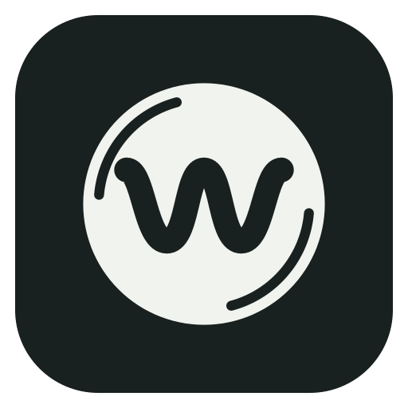

# Worbus for desktop

> **Download and issues: see [Worbus](https://github.com/illuminator69/worbus).** That is where the
> Worbus Server, both apps' downloads and the one issue tracker live. This repository holds the
> desktop app's code.

Worbus for desktop is a fork of Feishin by Jeff Li
([jeffvli/feishin](https://github.com/jeffvli/feishin)); all credit for Feishin itself belongs to
him and its contributors. Licensed GPL-3.0, like the original. Worbus is not affiliated with
Navidrome.

## What it is

A music player for your own music server (Navidrome, Jellyfin or any OpenSubsonic server), and a
client of the **Worbus Server**: a shared playback session across devices, and a front end for
**[lb-bot](https://github.com/illuminator69/lb-bot)**, which knows what your library is missing.
Its Android counterpart is **[Worbus for Android](https://github.com/illuminator69/worbus-android)**,
and the two are kept in step.

**The albums you don't own, on the artist page next to the ones you do.**


**Downloads are reviewed, not fired blind:** pick the edition, check it against the canonical
MusicBrainz tracklist, choose a quality, then look at real Soulseek sources ranked by coverage.


Also:

- **One session across devices.** The player bar drives local *or* remote playback; there is no
  separate remote UI. Move a song mid-play to a phone or a Chromecast and it resumes where it was.
  A play, pause, seek or volume change shows at once and holds until the server confirms it.
- **Devices.** The picker says what each device is and how loud it is, and any device's volume can
  be set from its own row, playing or not. The sleep timer belongs to the session, so it works from
  every device.
- **Chromecast bridge.** `bonjour-service` + `castv2-client` in the main process; no Cast SDK. Every
  discovered speaker is registered with the server so it shows up in every client's device picker.
- **Stations.** Radio and autoplay are computed by the Worbus Server from
  [AudioMuse-AI](https://github.com/NeptuneHub/AudioMuse-AI) (or Navidrome's similar songs alone),
  so every device continues the same station. Autoplay sits in the queue as four chips (Off,
  Close, Balanced, Explore), and a chip changes the upcoming songs at once on whichever device is
  playing. Without the server's engine, the built-in Auto DJ takes over.
- **Mixed for You.** Radio, Your mix (built from what you play most), Genre and Artist mixes,
  offered the same way as in Worbus for Android, plus AudioMuse's text-to-music search.
- **Discover and Listening.** A Discover page of rows (fresh releases, ListenBrainz playlists,
  rediscovery, similar artists, moods, mixes) and a listening-history page mirrored from
  ListenBrainz.
- **lb-bot in the library.** Missing albums and their review, downloads, a wishlist, library
  matches, and album and artist corrections, all through the server.
- **Saved queues / Continue Listening**, synced through the server and shared with Worbus for
  Android.

## Install

Follow [Worbus's install guide](https://github.com/illuminator69/worbus/blob/main/INSTALL.md): the
server comes first, then the apps. Nothing is code-signed: Windows shows a SmartScreen warning (if
Defender quarantines the installer, use the portable `.zip`), and the macOS builds are not
notarized, so Gatekeeper blocks them until you allow the app.

To build instead:

```bash
pnpm install
pnpm run build && pnpm exec electron-builder --linux --x64 --dir   # -> dist/linux-unpacked/
```

### Coming from Feishin

Worbus keeps its settings in its own folder: `~/.config/Worbus` on Linux, `%APPDATA%\Worbus` on
Windows, `~/Library/Application Support/Worbus` on macOS. The first time it starts it copies your
Feishin folder (`feishin`) into it: servers, themes, EQ presets, custom CSS and the rest. Feishin's
folder is left as it was, so Feishin keeps working.

- **The Worbus Server sign-in is not copied.** Worbus signs in as a new device, named after your
  computer; Feishin stays signed in.
- **Close Feishin first.** While Feishin is running Worbus copies nothing; it asks you to close
  Feishin and start Worbus again.
- **Saved passwords** may not survive the move on Linux, where the system keyring keys them by the
  app's name. Worbus then says so and asks you to sign in to that server once.

### Configuration

1. On first start you are asked for the path to your MPV binary. If you do not have MPV installed,
   download it [here](https://mpv.io/installation/) or install it with your package manager, then
   restart the app.
2. Add your music server: open the menu, **Manage servers**, **Add server**, and enter the full URL,
   with the protocol and port if needed (e.g. `https://navidrome.my-server.com` or
   `http://192.168.0.1:4533`).
    - **Navidrome**: select "Save password" and set Navidrome's `SessionTimeout` to a larger value
      (e.g. 72h).
    - **Linux**: the default password store is `libsecret`; `kwallet4/5/6` can be chosen in
      Settings > Window > Passwords/secret store.
3. _Optional_: app settings can be preset with `FS_` environment variables on first run (e.g.
   `FS_GENERAL_THEME=defaultDark`); see [the settings environment variables](docs/ENV_SETTINGS.md).

## FAQ

### MPV is either not working or is rapidly switching between pause/play states

Check that the MPV binary path in Settings is correct, set it again and restart the app. If that
does not help, reinstall MPV. `v0.35.x` and `v0.36.x` are known to work; `v0.34.x` is known broken.

### Which music servers work?

Any server with a [Navidrome](https://www.navidrome.org/), [Jellyfin](https://jellyfin.org/), or
[OpenSubsonic compatible](https://opensubsonic.netlify.app/) API. The Worbus Server's features
(sessions, stations, lb-bot) need Navidrome.

### "The SUID sandbox helper binary was found, but is not configured correctly" on Linux

User (unprivileged) namespaces are disabled (`sysctl kernel.unprivileged_userns_clone` returns 0).
Enable them, or make `chrome-sandbox` setuid:

```bash
chmod 4755 chrome-sandbox
sudo chown root:root chrome-sandbox
```

Ubuntu 24.04 changed how namespaces work; see its
[release notes](https://discourse.ubuntu.com/t/ubuntu-24-04-lts-noble-numbat-release-notes/39890)
for fixes.

### How can I add custom themes?

Drop JSON files into the Themes folder (Settings > General > Theme > Open Folder). See
[the custom themes documentation](docs/CUSTOM_THEMES.md).

## Development

Built with [electron-vite](https://github.com/alex8088/electron-vite) on Node 24 and pnpm (pinned
by `packageManager`).

- `pnpm run dev` - start the development app
- `pnpm run build` - build the app (main, preload, renderer and the remote page)
- `pnpm run package:linux` / `package:mac` / `package:win` - package locally
- `./node_modules/.bin/tsc --noEmit -p tsconfig.web.json --composite false` and
  `-p tsconfig.node.json` - type-check (the renderer, then main and preload)
- `node --test $(git ls-files '*.harness.ts')` - the harness tests
- `tools/check-names.sh` - no upstream name left where a person reads the app's name
- `pnpm run lint` / `pnpm run lint:fix` - lint

## Relationship to upstream

This fork merges upstream's releases by hand and is on upstream **`v1.17.0`**. Upstream's full
history is kept here so a fix can still be ported: add upstream's repository (linked above) as a
remote named `upstream` and merge or cherry-pick from its tags.

Translations come from upstream's [Weblate project](https://hosted.weblate.org/projects/feishin/)
and arrive with its releases; the brand word is changed here.

## License

[GNU General Public License v3.0](LICENSE), like the original.
